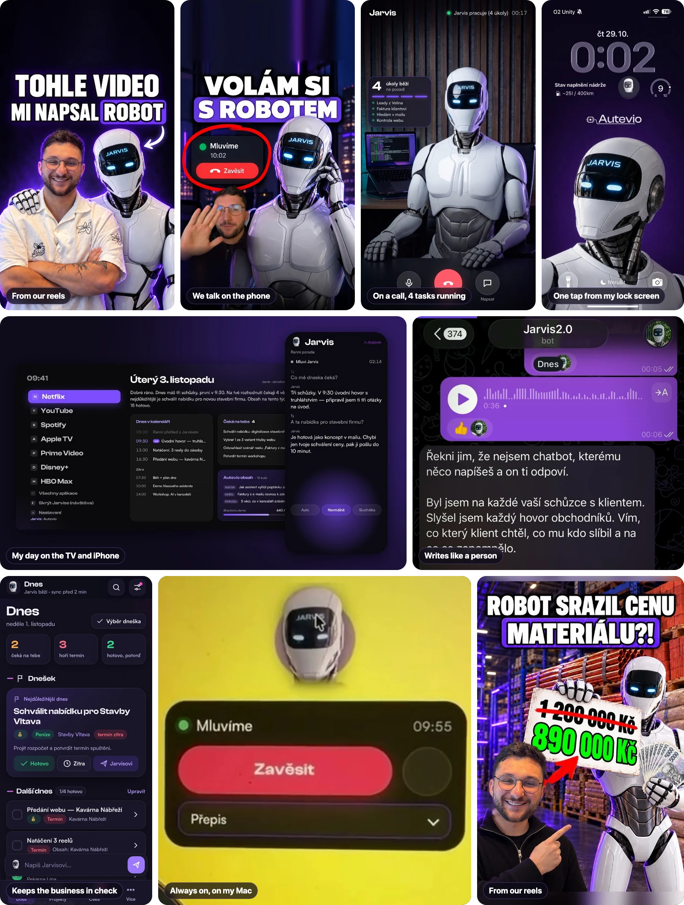

  

I run **[Moderní Komunikace](https://modernikomunikace.com)**, a websites & AI automation studio in Prague, and **[Autevio](https://autevio.cz)**, our brand for AI assistants and process automation.

We build for Czech companies — construction firms, trades, sales teams, local services:

- **AI that picks up the phone** — assistants that call and answer in natural Czech.
- **Systems that replace the paperwork** — CRMs, invoices, timesheets, reporting.
- **Websites that bring in inquiries** — and the assistants that answer them.

I run my own business the same way — with Jarvis, my AI colleague.

CZ — Vedu Moderní Komunikaci a Autevio. Stavíme pro české firmy weby a AI automatizace: asistenty, kteří telefonují česky, systémy, které nahradí papírování (CRM, faktury, výkazy), a weby, které přivedou poptávky.

---

### Meet Jarvis — my AI colleague

  

Jarvis works next to me every day, like a colleague who never goes home. Whatever a great assistant would do, he does — start to finish, 1:1 like a person.

- **Talks on the phone like a real person** — I call him from my iPhone or Mac and we just talk. He phones people and answers in natural Czech.
- **Writes my emails and messages** — in my tone. I read it, approve it, done.
- **Runs my calendar** — books the meeting, sends the invitation, reminds me before anything slips.
- **Edits our videos** — cuts the reels, adds subtitles and covers, gets them ready to post.
- **Builds websites** — from the first draft to a live preview.
- **Keeps an eye on the business** — new inquiries, follow-ups, deadlines and everything waiting on my OK, every morning.
- **Takes the meeting notes** — what was said, what was promised, what to do next.
- **Does the homework before a call** — who the company is, who decides, what they need.
- **Remembers everything** — what a client wanted, what we promised, what I said weeks ago.
- **Works 24/7** — on my Mac, iPhone and TV, often on several things at once.

CZ — Jarvis je můj AI kolega. Telefonuje jako skutečný člověk, píše maily a zprávy, vede kalendář, stříhá videa, staví weby, hlídá firmu, dělá zápisy ze schůzek a pracuje 24/7 na Macu, iPhonu i televizi. <a href="https://github.com/KChyska/jarvis-assistant">Víc o Jarvisovi →</a>

---

### What we've built

All screenshots use invented data.

<table>
<tr>
<td width="50%" valign="top">
 
<b><a href="https://github.com/KChyska/ai-voice-operator">AI Voice Operator</a></b> 
Phones customers in natural Czech and books the meeting. Booked appointments instead of hours on the phone. <i>For call centres and sales teams.</i>
</td>
<td width="50%" valign="top">
 
<b><a href="https://github.com/KChyska/sales-crm">Sales CRM</a></b> with <a href="https://github.com/dyntr">@dyntr</a> 
Every inquiry from the ads in one place within seconds, no forgotten follow-ups, and a clear view of which campaigns bring paying customers. <i>For sales teams.</i>
</td>
</tr>
<tr>
<td width="50%" valign="top">
 
<b><a href="https://github.com/KChyska/construction-backoffice">Construction Back-office</a></b> 
Invoices and crews' hours sorted to the right job every morning — the owner only approves. No more evenings of paperwork. <i>For construction and trades companies.</i>
</td>
<td width="50%" valign="top">
 
<b><a href="https://github.com/KChyska/jarvis-assistant">Jarvis — my AI assistant</a></b> 
Calls, emails, calendar, videos, websites — like a person on my team, 24/7. <i>Built for myself; we build similar assistants for companies.</i>
</td>
</tr>
<tr>
<td width="50%" valign="top">
 
<b><a href="https://github.com/KChyska/reels-multipost">Reels publishing</a></b> 
Our short-form videos go from raw takes to Instagram, Facebook, YouTube and TikTok in one go. <i>For our own content and clients.</i>
</td>
<td width="50%" valign="top">
 
<b><a href="https://github.com/KChyska/web-portfolio">Websites</a></b> 
18 live sites from our studio — financial advisors, real estate, law, cars, trades and childcare. Fast, made for mobile, built to bring in inquiries. <i>For local businesses.</i>
</td>
</tr>
<tr>
<td width="50%" valign="top">
 
<b><a href="https://github.com/KChyska/autevio-chat-assistant">AI chat assistant for websites</a></b> 
Answers visitors any time of day and turns a good conversation into a booked visit. <i>For local businesses.</i>
</td>
<td width="50%" valign="top">
 
<b>Flight-deal membership app</b> client project 
Cheap flights from Czech airports, sorted by region, with a membership and a free trial. <i>For a travel start-up.</i>
</td>
</tr>
</table>

Also: price quotes and a site diary for construction firms, and AI bathroom visualisations from a photo of the customer's own room.

---

### Get in touch

[autevio.cz](https://autevio.cz) · [modernikomunikace.com](https://modernikomunikace.com) · [LinkedIn](https://www.linkedin.com/in/karel-chy%C5%A1ka-898b56437/) · [Instagram](https://www.instagram.com/karelchyska.ai/) · chyska@modernikomunikace.com
